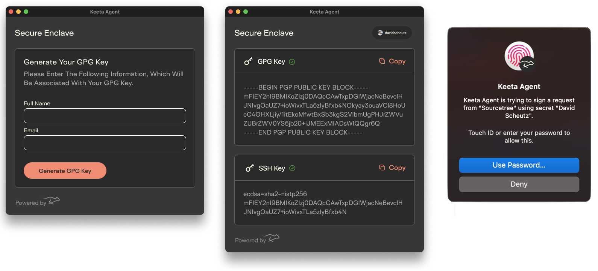
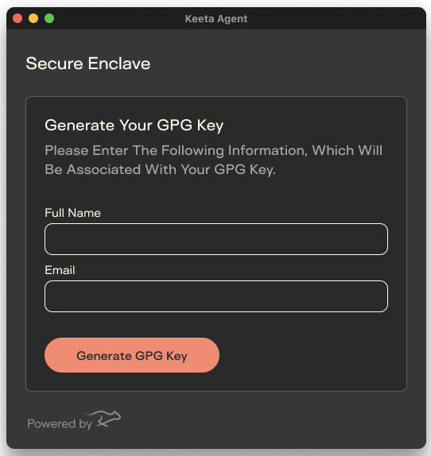
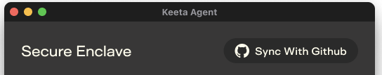

  
  
  

# Signet

Signet was called Keeta Agent before version 2.0. An installed Keeta Agent updates to Signet in place and keeps its keys.

    

Signet is a macOS toolbar app for automated key management of **GPG** and **SSH** keys using the Secure Enclave. It uniquely links `git` commits signed on your physical device to your connected GitHub account, increasing developer security.

It comes bundled with GnuPG distribution and an SSH Agent that bridges to Apple's native support for NIST P-256 elliptic curve (ECC) keys. 

## Why Signet?

### Secure Key Storage

Most people save GPG or SSH keys on their computer’s hard drive, protected by file permissions. While this is common, it's not completely secure - malicious users or malware could potentially copy these keys.

Signet stores keys in the Secure Enclave, Apple's Hardware Security Module (HSM), ensuring they are physically bound to your hardware and it becomes nearly impossible to export them.

### Access Control

Specifically designed for Apple Silicon Macs, Signet leverages advanced security features like Touch ID and Apple Watch authentication. It ensures that all requested actions are securely processed, requiring Touch ID authentication before proceeding.

### Automated Setup

Setting up GPG to sign git commits is typically a tedious [18-steps process](https://gist.github.com/troyfontaine/18c9146295168ee9ca2b30c00bd1b41e#file-2-using-gpg-md). Signet simplifies this by configuring `git` to sign in SSH's format with the Secure Enclave key, through Signet's socket, so apps that don't pass `SSH_AUTH_SOCK` on (Xcode, Tower) sign too. A git signing setup you already have, such as GPG, is left as it is.

### Github Integration

Seamlessly connect Signet to your GitHub account via Single Sign-On (SSO). All generated keys are automatically uploaded and linked to your account, the SSH key as a signing key too, so GitHub shows your SSH-signed commits as Verified.

### No Additional Hardware

Previously, secure key storage required a separate device, such as a YubiKey or smart card, adding complexity to the setup and introducing additional risks.

Signet eliminates the hassle of managing external devices, each with its own lifecycle and risk of being lost/stolen, by securely handling keys within your Mac.

## Getting Started

### Installation

#### 1. Direct Download

Download the latest release from the [Releases Page](https://github.com/KeetaNetwork/signet/releases). Each release is signed with Keeta, Inc's Developer ID and notarized by Apple ([RELEASING.md](RELEASING.md)).

#### 2. Setup

Provide the name and email you'd like to associate with your keys and GitHub commits.

#### 3. Connect Github

Link your GitHub account, and you're ready to go! ✅

### Backups and Transfers to New Devices

The Secure Enclave does not allow key export or transfer. If you switch to a new Mac, you'll need to generate new secrets specific to that machine.

### Control over SSH

As part of the automated management process, Signet will use the SSH key generated by the Secure Enclave instead of the default SSH handling within macOS, which may impact existing SSH configurations.

### Signet and Workspace for Mac

Workspace for Mac carries the same signing, so you don't need both. Signet serves your key on `~/Library/Signet/agent.sock`, and Keeta Agent's old path `~/Library/KeetaAgent/Data/socket.ssh` leads there. When Workspace for Mac already serves the socket, Signet stands by and takes over within a few seconds if Workspace quits. Both use the same Secure Enclave key: the bundle identifier `com.keeta.agent`, the keychain group `com.keeta.agent` and the key tag `com.keeta.agent.key` never change.

The shared core is the Swift package [SignetKit](SignetKit/README.md) in this repository.

## License

Signet is licensed under the [Creative Commons Attribution-NonCommercial 4.0 International Public License](LICENSE.md).

## Credit

[Secretive](https://github.com/maxgoedjen/secretive) and [Sekey](https://github.com/sekey/sekey) inspired our work on Signet (formerly Keeta Agent) but were rewritten and expanded to support unique use case and GPG key type.
